  

  

  Full stack developer with nearly 5 years of building web apps, currently owning internal tooling at <b>Delos Insurance Solutions</b>. 
  Off the clock: pro wrestling, video games, and lately, recompiling the classics I grew up on.

### Software Engineer · Delos Insurance Solutions
February 2026 – present

- **Main event:** building a customizable workflow dashboard so teams can shape the tool around how they actually work
- **Own the internal tooling,** including streamlined compliance tooling and agent management
- **Contributing to the architecture** of the Next-Gen Portal, Delos's primary product
- **Automated manual processes** like IVANS generation and SLA fallbacks, cutting lead time for non-technical teams by about 50%
- **Leveled up on the backend:** API development, database management, microservices, AWS, CI/CD pipelines, Playwright and Tableau

  

  

<table>
  <tr>
    <td width="50%" valign="top">
      
      A civic engagement app with interactive maps and charts that make political data easier to follow. 
      <a href="https://political-project-azure.vercel.app"><b>▶ Play</b></a> · <a href="https://github.com/nwester627/PoliticalTransparencyProject">Source</a>
    </td>
    <td width="50%" valign="top">
      
      My portfolio: projects, résumé and a working contact form in one fast single-page app. 
      <a href="https://www.nicolaswester.com"><b>▶ Play</b></a> · <a href="https://github.com/nwester627/ReactPortfolio2.0">Source</a>
    </td>
  </tr>
  <tr>
    <td width="50%" valign="top">
      
      Landing pages for local businesses, built and deployed end to end. 
      <a href="https://bes-plumbing.vercel.app"><b>▶ BES Plumbing</b></a> · <a href="https://maddysonpointcleaning.vercel.app"><b>▶ Maddy's On Point Cleaning</b></a> · <a href="https://fttr.vercel.app"><b>▶ FTTR</b></a>
    </td>
    <td width="50%" valign="top">
      
      A job search platform for finding roles, tracking applications and managing interviews in one place. 
      <a href="https://github.com/nwester627/Hired.io"><b>Source</b></a>
    </td>
  </tr>
</table>

  

  

  
  
  

